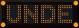

# INTUCH.PARTY

> A personal homepage with **Lil Uzi Vert *Eternal Atake / Uzi vs The World 2* energy** meets **90s webcore** aesthetic.



## What Is This?

My corner of the internet. **This repo is my learning project — I use it to practice HTML, CSS, and JavaScript in my free time.** No frameworks, no build tools, just pure web technologies. Think:

- **Purple space theme** — deep blacks, hot pinks, electric purples
- **90s web nostalgia** — table layouts, visitor counters, marquees, blinkies, guestbooks
- **Uzi album cover glitch aesthetic** — clipped text, chromatic aberration, chaotic energy

## Live

🌐 **https://intuch.party**

## Project Structure

```
intuch.party/
├── index.html          # Homepage (with visitor counter & guestbook)
├── about.html          # About Me
├── contact.html        # Contact Info
├── projects.html       # My Projects
├── links.html          # My Links
├── favicon.ico         # Favicon at root level
├── serve.py            # Local dev server with Flask API proxy
├── assets/
│   ├── css/
│   │   └── styles.css
│   ├── js/
│   │   ├── include.js  # Sidebar component loader
│   │   └── main.js     # Visitor counter & guestbook API client
│   ├── images/
│   │   └── all image
│   ├── fonts/
│   │   └── all local font
│   └── db/
│       ├── app.py      # Flask API for visitor counter & guestbook
│       ├── visitors.json
│       └── guestbook.json
└── components/
    └── sidebar.html    # Single source of truth for sidebar
```

## Design System

### Colors
| Role | Hex | Usage |
|------|-----|-------|
| Background | `#160B2B` | Page bg |
| Text | `#E8DDF5` | Body copy |
| Header/Accent | `#D9B8FF` | Site title |
| Links | `#FF8BDF` | Hot pink links |
| Visited | `#B99AE8` | Muted purple |
| Headings | `#C99AFF` | Section titles |
| Container | `#241044` | Table bg |
| Borders | `#7040A8` | Table borders, hr |

### Fonts
- **Body**: `Geist Pixel` (Google Fonts + local `assets/fonts/geist-pixel.woff2` fallback)
- **Display**: `Pixelify Sans` (Google Fonts + local `assets/fonts/pixelify-sans.woff2` fallback)
- **Fallback**: `Courier New`, monospace

### Layout
- Fixed **760px** centered container (classic 90s width)
- Table-based: sidebar (180px) + main (580px)
- Full viewport height (`100vh`)

## Roadmap

- [x] Phase 1: Foundation — assets, HTML fixes, font loading
- [x] Phase 2: 90s/Webcore Features — counter, marquee, GIFs, guestbook, glitch effects
- [x] Phase 3: JSON Data System — split visitors.json & guestbook.json *(no database)*
- [x] Phase 4: Pages — about, projects, links, contact
- [ ] Phase 5: Polish — CSS variables, mobile, JS modules, glitch text, music player

## License

MIT — see [LICENSE](LICENSE)

---

*Made with 💜 by [@Intuch1355](https://github.com/Intuch1355)*
